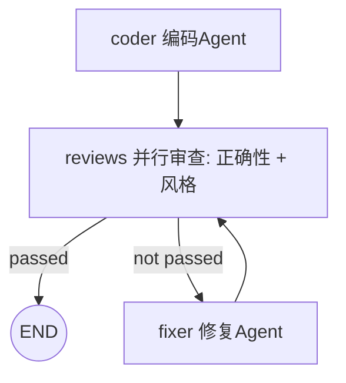

# Simple Workflow MVP — 软件工程 Homework 2

一个**多 Agent 协作工作流**：`编码 Agent → 并行双路审查（正确性 + 风格）→ （任一不通过则）修复 → 再审查`，
端到端地把一句自然语言需求变成一份通过审查、可直接运行的 Python 代码。

## 流程图



（`python main.py --viz` 打印上图源码；`python main.py` 运行后还会在 `runs/` 生成
**自包含 HTML 回放页**——流程图、步骤时间线、消息记录、最终产物，浏览器打开即可，无需联网）

## 对照作业要求

| 要求 | 实现 |
|---|---|
| 至少 2 个 Agent 协作 | 4 个：Coder / CorrectnessReviewer / StyleReviewer / Fixer |
| Agent 间消息传递或状态共享 | 两者都有：共享黑板 `WorkflowState.data` + 每次交接记录为消息信封（并写入 JSONL 日志） |
| 顺序执行流程控制 | 声明式 JSON 流程定义（`flows/`），引擎按边推进 |
| 条件分支、循环（推荐） | 边可带 `when` 条件表达式；`fixer → reviews` 回边构成修复-复审循环 |
| **并行执行**（推荐） | 并行 stage：正确性审查与风格审查**并发执行**（fork/join 融合为一个节点），`merge_reviews` reducer 汇合双路结论；实测总耗时 ≈ 较慢一路而非两路之和 |
| **可视化编排**（推荐，可选） | `runs/run-*.html` 离线回放页：SVG 流程图（标注执行次数）+ 步骤时间线（含并行任务耗时明细）+ 消息记录 + 产物查看；`--replay` 可对历史日志重新生成 |
| 执行日志与状态追踪（推荐） | 每步写入 `runs/run-*.jsonl`（节点、耗时、状态、错误、并行任务明细），消息亦全量落盘 |
| 错误处理与恢复（推荐） | 节点失败自动重试；LLM 调用指数退避；循环有步数/访问上限，超限优雅中止 |
| 复用项目 1（推荐） | `workflow/llm.py` 复用作业 1 的 ChatClient；`workflow/tools.py` 复用「运行代码验证」思路，正确性审查 Agent 会**真实执行**被审代码 |

## 快速开始

```bash
# 1. 配置（与作业 1 相同）
cp config.example.json config.json   # 填入 base_url / api_key / model

# 2. 端到端运行（默认并行流程 + samples/requirement.md）
python main.py

# 3. 换需求 / 换流程
python main.py --requirement my_requirement.md
python main.py --flow flows/code_review.json   # 顺序版流程（单审查员）

# 4. 流程图与回放
python main.py --viz                            # Mermaid 源码
python main.py --replay runs/run-XXXX.jsonl     # 历史日志 → HTML 回放页

# 5. 离线演示 / 自测（无需 API Key）
python main.py --demo
python tests/test_workflow.py                   # 16 项测试
```

零第三方依赖，Python 3.9+ 即可运行。

## 一次真实运行记录（并行版）

```
流程: code-review-workflow-parallel
  [step] coder (visit 1) -> code  5247ms
  [step] reviews (visit 1) -> review  3391ms
      └─ 并行 correctness(reviewer_correctness) 1049ms
      └─ 并行 style(reviewer_style) 3387ms      ← 总耗时≈较慢一路，确为并发
状态: success
审查结论: ✅ 通过（正确性无问题；风格给出 7 条 low 级建议，均标注来源 [style]）
最终代码已写入: output/final_code.py（实测运行，5 项需求全部符合）
```

## 项目结构

```
├── main.py               # CLI 入口（run / --flow / --viz / --replay / --demo）
├── workflow/
│   ├── engine.py         # 工作流引擎：声明式 DAG + 条件边 + 并行 stage + 循环守卫 + JSONL 日志
│   ├── state.py          # 共享状态：黑板 + Agent 消息日志
│   ├── agents.py         # 4 个 Agent + merge_reviews reducer
│   ├── llm.py            # OpenAI 兼容客户端（复用自作业 1，含重试）
│   ├── tools.py          # 沙箱执行工具（复用自作业 1，审查时真实跑代码）
│   └── viz.py            # 离线 HTML 回放页生成器（纯 SVG/JS，无外部依赖）
├── flows/
│   ├── code_review_parallel.json  # 默认流程：并行双路审查
│   └── code_review.json           # 顺序版流程（单审查员，用于对照）
├── samples/requirement.md# 示例需求
├── tests/test_workflow.py# 离线测试：16 项（解析器/reducer/顺序流/并行流/回放页）
└── runs/                 # 每次运行的 JSONL 日志 + HTML 回放页
```

设计取舍与扩展方法见 [Design.md](Design.md)。
