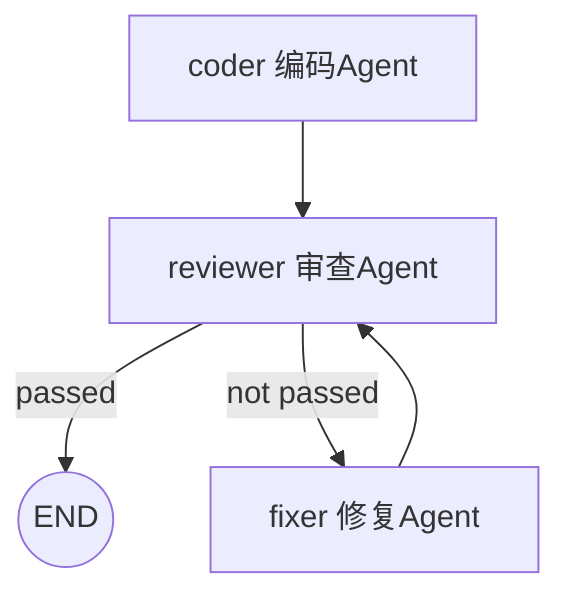

# Simple Workflow MVP — 软件工程 Homework 2

一个**多 Agent 协作工作流**：`编码 Agent → 审查 Agent → 修复 Agent` 组成
「编码 → 审查 → （不通过则）修复 → 再审查」的循环流程，端到端地把一句
自然语言需求变成一份通过审查、可直接运行的 Python 代码。

## 流程图



（在支持 Mermaid 的 Markdown 阅读器中可直接渲染；`python main.py --viz` 会打印上图源码）

## 对照作业要求

| 要求 | 实现 |
|---|---|
| 至少 2 个 Agent 协作 | 3 个：CoderAgent / ReviewAgent / FixAgent |
| Agent 间消息传递或状态共享 | 两者都有：共享黑板 `WorkflowState.data` + 每次交接记录为消息信封（`state.messages`） |
| 顺序执行流程控制 | 声明式 JSON 流程定义（`flows/code_review.json`），引擎按边推进 |
| 条件分支、循环（推荐） | 边可带 `when` 条件表达式；`fixer → reviewer` 回边构成修复-复审循环 |
| 执行日志与状态追踪（推荐） | 每步写入 `runs/run-*.jsonl`（节点、耗时、状态、错误），运行结束写汇总 |
| 错误处理与恢复（推荐） | 节点失败自动重试；LLM 调用指数退避；循环有步数/访问上限，超限优雅中止 |
| 复用项目 1（推荐） | `workflow/llm.py` 直接复用作业 1 的 ChatClient；`workflow/tools.py` 复用「运行代码验证 bug」的思路，审查 Agent 会**真实执行**被审代码再下结论 |

## 快速开始

```bash
# 1. 配置（与作业 1 相同）
cp config.example.json config.json   # 填入 base_url / api_key / model

# 2. 端到端运行（默认使用 samples/requirement.md）
python main.py

# 3. 换自己的需求
python main.py --requirement my_requirement.md

# 4. 查看流程图（Mermaid）
python main.py --viz

# 5. 离线演示 / 自测（无需 API Key）
python main.py --demo
python tests/test_workflow.py
```

零第三方依赖，Python 3.9+ 即可运行。

## 一次真实运行记录

```
流程: code-review-workflow — 编码 → 审查 → (不通过则)修复 → 再审查 的循环工作流
  [step] coder (visit 1) -> code  3619ms
  [step] reviewer (visit 1) -> review  1250ms
状态: success
审查结论: ✅ 通过 —— 代码逻辑正确，边界与异常处理完善，输出与预期一致
最终代码已写入: output/final_code.py
```

产物 `output/final_code.py` 是一个命令行 Todo 管理模块，实际运行验证了
添加/完成/排序/非法输入处理全部符合需求。

## 项目结构

```
├── main.py               # CLI 入口（run / --viz / --demo）
├── workflow/
│   ├── engine.py         # 工作流引擎：声明式 DAG + 条件边 + 循环守卫 + JSONL 日志
│   ├── state.py          # 共享状态：黑板 + Agent 消息日志
│   ├── agents.py         # 三个 Agent（提示词 + 结构化输出解析）
│   ├── llm.py            # OpenAI 兼容客户端（复用自作业 1，含重试）
│   └── tools.py          # 沙箱执行工具（复用自作业 1，审查时真实跑代码）
├── flows/
│   └── code_review.json  # 流程定义：节点 + 条件边（改流程不用改代码）
├── samples/requirement.md# 示例需求
├── tests/test_workflow.py# 离线测试：FakeLLM 驱动完整流程（9 个用例）
└── runs/                 # 每次运行的 JSONL 执行日志
```

设计取舍与扩展方法见 [Design.md](Design.md)。
